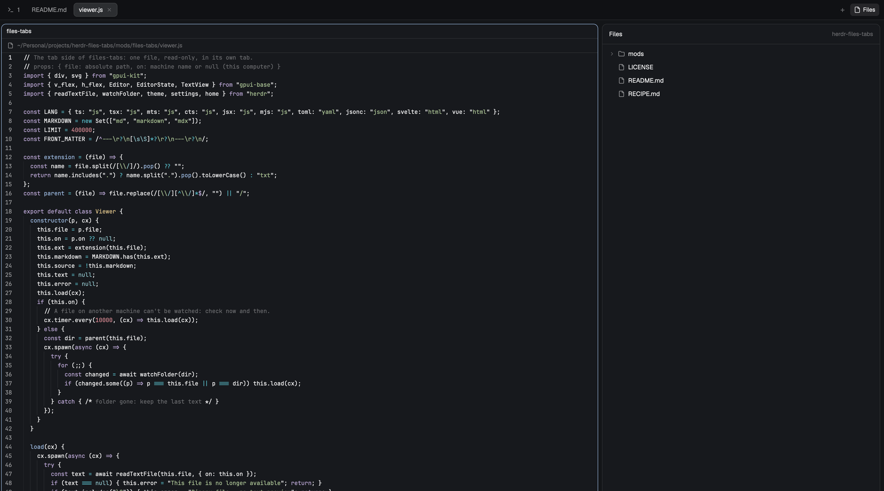

# Files in Tabs

A [Herdr](https://herdr.dev) layout: Herdr's own window, except that clicking
a file in the Files panel opens it in its own tab. Code shows with syntax
colors and line numbers, and Markdown shows rendered. Clicking the same file
again goes back to its tab.



## Install

Give your agent this line:

```
Add the Herdr layout at github.com/erickmenezes/herdr-files-tabs
```

Or copy `layouts/Files-Tabs.json` and `layouts/Files-Tabs.svg` into
`~/.config/herdr-app/layouts/`, and `mods/files-tabs/` into
`~/.config/herdr-app/mods/`. Then pick "Files-Tabs" in Settings → Look.
`ctrl-shift-l` switches back to your usual layout.

What it touches: it runs `sh` (to list folders) and `git status`, reads the
files you click, and reaches no network.

## License

Apache-2.0. Based on the `main` layout and the Files mod that ship with
Herdr; the changes are listed in [RECIPE.md](RECIPE.md).
