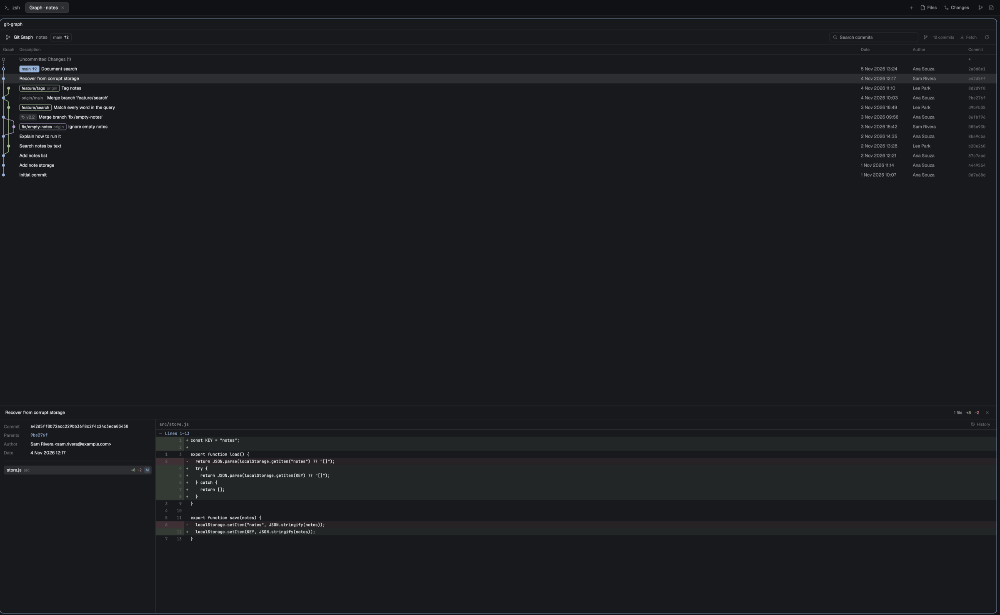

# Bench

A [Herdr](https://herdr.dev) layout: Herdr's own window, with more to work
with beside your agents.

- **Files in tabs.** Double-click a file in the Files panel and it opens in its own
  tab: code with syntax colors and line numbers, Markdown rendered, pictures
  (PNG, JPEG, GIF, WebP, SVG…) fitted to the tab. Text files on this computer are
  editable: ⌘S saves (Ctrl+S on Linux and Windows), and if the file changed on
  disk since, it asks (Reload or Overwrite) instead of writing over it. Unsaved
  edits survive a restart. Clicking it again goes back to its tab. Files and folders get colour icons (VS Code's Material Icon Theme,
  through the bundled Better Icons mod), each file shows its size, and a
  double-click on a folder shows it as the root, with buttons for up one
  level and back to the terminal's folder. A file tab follows its file when
  it's renamed or moved.
- **A right-click menu** on every row: Open, Show as Root, New Terminal Here,
  Open with Default App, Reveal in Finder, Cut, Copy, Paste, Copy Path, Copy
  Relative Path, New Folder…, Rename… and Move to Trash… (never a plain
  delete). ⌘-click or ⇧-click selects several rows, to cut, copy, copy the
  paths of or trash them together. Right-click the empty space for New
  Folder… and Paste at the top.
- **Keyboard and a quick filter.** Click the panel, then use ↑/↓ (⇧ to
  extend), ←/→ to close and open folders, ⌘C/⌘X/⌘V and ⌥⌘C for the path. On
  macOS the keys follow Finder: Enter renames, ⌘↓ or ⌘O opens, ⌘⌫ moves to
  the Trash, ⌘↑ goes up a level. On Linux and Windows, Enter opens, F2
  renames, Delete moves to the Trash, Alt+↑ goes up (Ctrl in place of ⌘).
  Just type to filter: the panel lists every file and folder below the root
  whose name contains the text; Esc clears it.
- **Claude's limits.** Above Agents, a Limits panel shows how much of
  Claude's session (5-hour) and weekly limits you've used, per account, with
  each account's plan, and a notification when one reaches 80% and 100%.
- **A Git Graph.** A graph button after Files in the tab bar opens the
  focused terminal's repository as a graph in its own tab, like VS Code's
  Git Graph: coloured branch lanes, branch, remote and tag labels, date,
  author and hash, and an "Uncommitted Changes" row on top. Click a commit
  for its message and changed files, and a file for its diff; ↑/↓ move
  through commits. Search narrows the list by message, author, hash or
  branch, a toggle shows only the current branch, and each branch shows how
  many commits it has to push and pull (↑2 ↓5). A file's History button
  lists every commit that changed it, following renames. Right-click a
  commit to check it out, branch from it, cherry-pick or revert it, or to
  check out, pull, push, rename or delete a branch on it; Fetch in the header
  updates the remotes. Stashes show as rows on the commit they were made on,
  with their diff; right-click one to apply, pop or drop it, or the
  Uncommitted Changes row to stash. While a merge, rebase, cherry-pick,
  revert or bisect is under way, a banner says so, counts the files still in
  conflict, and offers Continue and Abort. It follows new commits and
  branches as they happen.
- **A Scratchpad.** A note button after Files in the tab bar (or
  `cmd-shift-n`) opens an empty tab for quick plain-text notes that stays
  until you close it. "Save as…" (⌘⇧S) turns a note into a real file, and
  ⌘S saves to it again.



## Install

Give your agent this line:

```
Add the Herdr layout at github.com/erickmenezes/herdr-bench
```

Or copy `layouts/Bench.json` and `layouts/Bench.svg` into
`~/.config/herdr-app/layouts/`, and the six folders in `mods/`
(`files-tabs`, `better-icons`, `claude-limits`, `scratchpad`, `tab-bar-extras`,
`git-graph`)
into `~/.config/herdr-app/mods/`. If you already have Better Icons installed,
keep yours: other mods find it by the same name. Add the key in
`keys.json` (`cmd-shift-n`, a new scratchpad) to your own `keys.json`, unless
you already use that key. Then pick "Bench" in Settings → Look.
`ctrl-shift-l` switches back to your usual layout.

The Limits panel gets its numbers from Claude Code's status line, which is
the only place Claude Code shares them. Add this line to your status line
script, right after it reads its input into `$input`:

```sh
printf '%s' "$input" | bash ~/.config/herdr-app/mods/claude-limits/save-limits.sh
```

It needs `jq`. Each Claude config folder (`~/.claude`, or whatever
`CLAUDE_CONFIG_DIR` points to) gets its own row. Without a status line, the
panel says so and stays empty.

What it touches: the Files panel runs `sh` (to list folders), `stat`,
`find` (for the filter) and `git status`, reads the files you click, and, only from its right-click
menu, `open`, `pbcopy` (or `wl-copy`/`xclip`/`xsel`), `mkdir`, `cp -R -p` to
paste a copy, `mv -n` to rename or paste a cut, and
`/usr/bin/trash` (else Finder via `osascript`; `gio trash` or `trash-put` on
Linux and SSH machines) to move to the Trash. The Git Graph runs `git`
to read (`log`, `show`, `diff`, `status`, `for-each-ref`, `stash list`, and
the files git keeps in `.git` during a merge or rebase), and changes the
repository only from its right-click menu, its banner and Fetch button:
`switch`, `branch`, `cherry-pick`, `revert`, `stash`, `--continue`/`--abort`
of the operation under way, `bisect reset`, `pull --ff-only`, `push` (never
forced) and `fetch --all --prune`, the last three reaching your remotes.
Detaching HEAD, cherry-picking, reverting, deleting, pushing, stashing,
dropping a stash and aborting ask first. The Limits
panel runs `sh` to read `~/.cache/herdr-claude-limits/`, which
`save-limits.sh` writes. Apart from the Git Graph's fetch, pull and push,
none of this reaches the network or reads your Claude login. Scratchpad notes are kept
in Herdr's own storage for that mod, and only written to a file you pick in the
system's save dialog (`osascript` on macOS, `zenity` or `kdialog` on Linux). Better Icons (about 5 MB of
icons) only reads its own folder.

## License

Apache-2.0. Based on the `main` layout and the Files mod that ship with
Herdr; the changes are listed in [RECIPE.md](RECIPE.md). Bundles
[Better Icons](https://github.com/munza/herdr-mods/tree/main/better-icons)
(Apache-2.0) with its Material Icon Theme icons (MIT); see [NOTICE](NOTICE).
