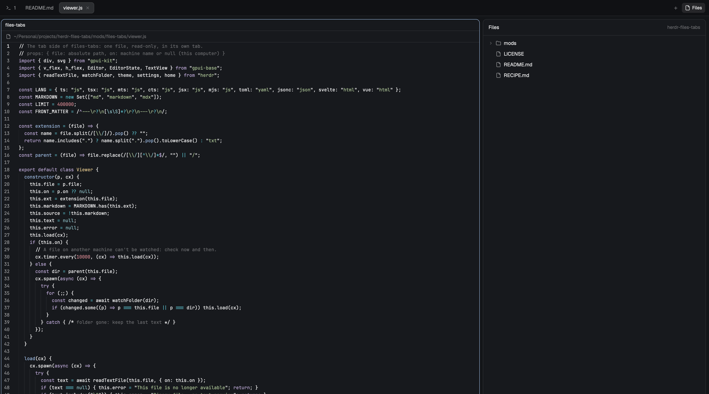

# Files in Tabs

Herdr's own window (the `main` layout), except that in the Files panel
clicking a file opens it in its own tab instead of a preview squeezed into
the panel. The tab is named after the file
and shows it read-only: code with syntax colors and line numbers, Markdown
rendered (with a Source button to see the raw text). Clicking the same file
again goes back to its tab instead of opening another. The panel keeps showing
the project's folder while a file tab is in front.

## What you see

- **The panel** (in the right-hand side panel, where Herdr's Files is): looks
  like Herdr's Files. A 42px header with "Files" (semibold) on the left and
  the folder's name on the right (12px, `dim`; `foreground` while a folder
  is shown as root), then a 24px "Up one level" button (14px up arrow,
  `dim`, `hover` background) unless the folder is `/`, and, while a folder
  is shown as root, a "Back to the terminal's folder" button (a folder with
  a check). Below, a scrolling tree with
  6px padding: rows 28px high, indented `8 + 18 × depth` px, rounded 7px,
  `hover` background on hover. Each row: a 12px chevron for folders (right
  when closed, down when open; files get a 12px gap instead), a 14px folder
  or file icon in `muted`, the name (truncated), for a file its size (11px,
  `dim`: "79 B", "4.2 KB", "18 KB", "3.1 MB", in 1024s, one decimal below
  10), and a git mark on the right
  for changed files (11px): `A` in `ansi2` (added or untracked), `D` or `U`
  in `ansi1` (deleted, conflicted), `M` in `blocked` (modified). Folders come
  first, then files, each sorted by name; `.git` is hidden. The panel card
  has a 1px `border` and 10px corners on the `background` color.
- **A file tab**: a tab named after the file (`README.md`), with one mod pane
  filling it. At the top, a 30px bar with a 13px file icon, the file's path
  (12px, `dim`, with your home folder shown as `~`; `machine:` in front for a
  file on another machine) and, for Markdown and SVG files, a small 11px
  "Source" / "Preview" button on the right. Under it, the file:
  - Code and text: a read-only editor with line numbers, folding and syntax
    colors in your theme (keywords `ansi5`, strings `ansi2`, comments `dim`,
    functions `ansi4`, types `ansi3`, numbers `ansi1`, constants `ansi6`),
    12px in your terminal font.
  - Markdown (`.md`, `.markdown`, `.mdx`): rendered, selectable, with 20px
    side and 14px top/bottom padding. A YAML front matter block (`---` …
    `---` at the top) is hidden in the rendered view and shown in Source.
  - Pictures (`.png`, `.jpg`, `.jpeg`, `.gif`, `.webp`, `.bmp`, `.ico`,
    `.svg`): centered with 16px padding, at their own size or the tab's,
    whichever is smaller. A file on another machine says "Picture preview
    works for files on this computer only".
  - Messages instead of content: "Loading file…", "Binary file · no text
    preview", "This file is no longer available", or "Cannot open this file
    (binary, larger than 1 MiB, or unreadable)".
- **The Limits panel** (in the left sidebar, between Spaces and Agents, 160px
  high, `chrome` background, 1px `border` on top): a header "Limits" styled
  like Agents' (11.5px, medium, `dim`, 16px side padding, 41px high). Per
  account, two meters, "Session" (the 5-hour window) and "Weekly": the name
  in `muted`, the percentage (medium; `foreground` under 50%, else the bar's
  color) and "resets in 1h 12m" on the right (11px, `dim`); under them a 4px
  bar on `raised`, filled to the percentage in `accent` under 50%, `ansi3`
  under 80%, `blocked` from 80%. Each account gets a row above its meters:
  Herdr's 13px Claude icon (`image("icons/claude.svg")`, sized with
  `.w()`/`.h()`), its name (`~/.claude` → "Claude", `~/.claude-personal` →
  "Personal"), and its plan in a small pill (10px, medium, `muted` on
  `raised`, 4px corners), such as "Pro", "Max 5x" or "Team Max 5x". With no saved limits: "No limits yet. They show up once a
  Claude session's status line runs save-limits.sh."
- **After the tab bar's Files button**, on the tab bar's `chrome`
  background and bottom border: a 26px note button with a 15px note icon
  (`dim`, `hover` background and `foreground` on hover, 6px corners),
  tooltip "New scratchpad (⌘⇧N)".
- **A scratchpad tab**: named "Scratchpad", one mod pane with a plain-text
  editor (13px, your terminal font, no line numbers, soft wrap, 6px padding)
  on `background`.

## How it behaves

- Double-click a folder: it becomes the panel's root. Up one level shows
  the parent as root (also above the terminal's folder), Back to the
  terminal's folder ends it. The root is kept per terminal location (space,
  machine, folder): `cd` elsewhere and the panel follows the terminal again;
  come back and the pinned root is there.
- Right-click a row: a menu like Herdr's own (31px rows, `selected` for the
  keyboard's row, `hover`, dividers in `border`; ↑/↓, Enter, Esc). A file:
  Open, Open with Default App, Reveal in Finder; a folder: Show as Root, New
  Terminal Here (a terminal tab in that folder); then Cut, Copy and, once
  something was cut or copied, Paste (on a folder "Paste into “name”");
  then Copy Path, Copy Relative Path (to the panel's root); then New
  Folder…, Rename…, Move to Trash…. Right-click the tree's empty space: New
  Folder…, Paste, Reveal in Finder, Copy Path, for the panel's root. Default
  app and Finder only for files on this Mac; the file actions not on
  Windows. A copied path says so in a 2-second toast.
- Cut and Copy remember one item in the files' own clipboard (shared
  `"files-tabs.clipboard"`: `{ path, on, mode, dir }`), not the text one; a
  cut item shows at half opacity until it's pasted. Paste goes into the
  folder clicked, or the file's folder. A copy never replaces anything: a
  taken name becomes "a copy.txt", then "a copy 2.txt" (a folder keeps its
  whole name before " copy"). A cut is refused over an existing name,
  changes nothing where it already is, and empties the clipboard once
  pasted. A folder can't go into itself or below itself. Between two
  machines (or this computer and one) Paste says it isn't supported yet.
  After a paste or a new folder inside a folder, that folder opens.
- New Folder… opens the Rename dialog's twin: "New folder", "untitled
  folder" selected, Create; a name with "/" or one that exists is refused.
- Rename… opens a dialog like Herdr's prompt: the name with its stem
  selected (all of it for a folder or a dotfile), Enter or Rename, Esc or
  Cancel. A name with "/" or one that already exists there is refused in the
  dialog; nothing is overwritten.
- Move to Trash… opens a dialog like Herdr's confirm: "Move “name” to the
  Trash?", with the path, Enter or Move to Trash. It only ever moves to a
  Trash; with none on that machine it says so and deletes nothing.
- Click a folder: it opens or closes in place. Click a file: a new tab opens
  in the shown space, named after the file, and becomes the shown tab.
- Click a file that already has a tab: that tab is shown again; no second tab.
  This works across restarts as long as the tab is still open.
- The panel follows the focused terminal's folder, like Herdr's Files. When the
  focused pane is a file tab (which has no folder of its own), the panel stays
  on the last terminal folder seen in that space, or the folder of any
  terminal in that space, instead of jumping to the home folder.
- The tree refreshes when anything in the folder changes (and every 10 s); git
  marks refresh with it.
- A file tab reloads by itself when the file changes on disk (local files are
  watched; files on another machine are re-read every 10 s). "Source" /
  "Preview" switches a Markdown tab between raw text and rendered text.
- Close a file tab like any tab. Agent statuses play no part in this mod.
- Limits update within a second of a Claude session's status line running
  (the panel watches the folder), and every 30 s the countdowns move on. A
  window whose reset time has passed shows 0% and "reset". A snapshot older
  than 30 minutes says "as of 2h 5m ago" above its meters.
- The note button, or `cmd-shift-n`, opens a new scratchpad tab in the shown
  space and shows it. Each one starts empty; its text is saved on every
  change and survives restarts and updates while the tab stays open. Closing
  the tab is the end of that note.

## Built from

- One layout file, `layouts/Files-Tabs.json`: a clone of Herdr's
  `main` layout (`cloned_from: {name: "main", version: "0.1.13"}`) with
  one change: the block with id `files` (in the right panel's stack
  `panel-body`) has `content.mod` set to `files-tabs` instead of `files`.
  Keep that id, because the tab bar's Files button selects it. The root also
  has `"preview": "layouts/Files-Tabs.svg"`, the picture Settings shows.
  It also adds a block `limits` (`size: {px: 160}`, `min: 80`, mod
  `claude-limits`) in `sidebar-lists` between `spaces` and `agents`. The
  `tabs` block (still Herdr's own `tabs` mod) goes into a row `tab-bar`
  (`size: {px: 42}`, `resizable: false`) with `size: {weight: 1}`, followed
  by a block `tab-bar-extras` (`size: {px: 36}`, mod `tab-bar-extras`).
- One mod folder, `mods/tab-bar-extras/`: `main.js`, `mod.json`
  (`"place": "none"`) and `note.svg`. The note runs
  `mod.open {name: "scratchpad"}`. More buttons beside the tab bar go here.
- One mod folder, `mods/scratchpad/`: `main.js` and `mod.json`
  (`"place": "none"`, `"overlay": {width: 1, height: 1}`).
  `main.js` default-exports a `View` with two roles, chosen by `props()`:
  - **`{ id }` → a note tab**: `EditorState.new({ value, font_family,
    font_size: 13, line_numbers: false, folding: false, soft_wrap: true })`,
    with the text in `localStorage` under `note:<id>` on every `change`.
    `close()` saves and `await localStorage.flush()` but doesn't delete it:
    `close()` also runs when Herdr quits.
  - **`{ overlay }` → `mod.open:scratchpad`**: closes the overlay and opens a
    tab, `run("tab.new", { name: "Scratchpad", space: <shown space id>,
    mod: "scratchpad", props: { id: <new random id> } })`.
- `keys.json`: `{"global": {"cmd-shift-n": "mod.open:scratchpad"}}`.
- One mod folder, `mods/claude-limits/`: `main.js`, `mod.json`
  (`"place": "none"`, `"title": "Limits"`) and `save-limits.sh`.
  - `save-limits.sh` reads the status line's JSON on stdin and, with `jq`,
    writes `{account, plan, updated, rate_limits}` on one line to
    `~/.cache/herdr-claude-limits/<account>.json`, where the account is the
    basename of `CLAUDE_CONFIG_DIR` (default `~/.claude`) without its dot. It
    rewrites only when `rate_limits` changed or the file is a minute old,
    through a temp file and `mv`. `plan` comes from `oauthAccount` in
    `$CLAUDE_CONFIG_DIR/.claude.json`, or `~/.claude.json` when that isn't
    set (not `~/.claude/.claude.json`, which can be an old leftover):
    `organizationType` without `claude_`, capitalized. Max adds the `5x`/`20x`
    ending of its rate limit tier ("Max 5x"). Team adds "Max" and the ending
    of `userRateLimitTier`, the seat's own tier, when it has one
    ("Team Max 5x", else "Team"). "" if unknown. `rate_limits` is what Claude Code passes:
    `five_hour` and `seven_day`, each `{used_percentage, resets_at}` (Unix
    seconds).
  - `main.js` default-exports a `View`: it reads every snapshot with one
    `exec("sh", ["-c", 'for f in "$1"/*.json; do [ -f "$f" ] && cat "$f" && echo; done', "limits", dir])`,
    sorted by account; reloads on `watchFolder(dir)` and `cx.timer.every(30000)`.
- One mod folder, `mods/files-tabs/`: `main.js`, `viewer.js`, `menu.js`,
  `dialog.js`, `file-icons.js`, `mod.json` (`"place": "none"`: it shows only where the
  layout puts it), and six icons (`chevron-down.svg`, `chevron-right.svg`,
  `file.svg`, `folder.svg`, `up.svg`, `home.svg`).
- Sizes come from the same `sh` listing as the tree, with no extra call: it
  prints each entry as `kind\0name\0` (at most 500), then the pair `z\0z\0`,
  then one `stat -L` for all the folder's files, `stat -c "%s %n"` where GNU
  stat answers `stat -c %s /`, else BSD's `stat -f "%z %N"`. The fields are
  read in pairs, since a name can be "z" and a kind (d or f) can't; each
  `<bytes> <path>` line gives the size for that name. Windows folders have no
  sizes.
- The row menu (`menu.js`) and the dialogs (`dialog.js`) are more copies of
  `files-tabs`, chosen by `props()`: `{ menu }` as a popup (230px wide),
  `{ dialog }` as a dialog (440px wide). Each copy has its own module state,
  so what the panel must do (open a file in a tab, Show as Root, reload
  after a rename or a trash) goes to it as shared `"files-tabs.request"`:
  `{ id, at, location, kind: "open" | "root" | "refresh" | "expand", path }`
  (expand: reload with that folder and its parents open); the panel acts
  once per id, only for its own terminal location and within 5 s.
  Commands: `open` / `open -R`; `printf %s "$1" | { pbcopy || wl-copy ||
  xclip -selection clipboard || xsel -b; }`; rename `cd "$1"; [ -e "$3" ] ||
  [ -L "$3" ] && exit 3; mv -n -- "$2" "$3"` on the file's machine; trash
  `/usr/bin/trash "$1"` (macOS 15+), else Finder `delete` through
  `osascript` with the path as an argument; elsewhere `gio trash --` or
  `trash-put --`, else exit 4 ("no Trash"). Never `rm`. New folder: `cd "$1";
  [ -e "$2" ] || [ -L "$2" ] && exit 3; mkdir -- "$2"`. Paste, on the
  machine of both: refuse a folder into itself (`case "$dir/" in "$src"/*`,
  exit 5) and a missing source (exit 4); a cut is `mv -n` unless the name is
  taken (exit 3); a copy finds a free "stem copy[ n].ext" and runs
  `cp -R -p`.
- Show as Root: a module-level map from the terminal location (the JSON of
  `{cwd, on, space}`) to a pinned folder; the panel's folder and its cache
  key come from that pinned folder when there is one. Double-click comes
  from `on_click`'s `click_count >= 2`.
- One bundled mod folder, `mods/better-icons/`: [Better Icons](https://github.com/munza/herdr-mods/tree/main/better-icons)
  as published (commit `ffbdb6d`, Material Icon Theme 5.40.0: `icons.json`,
  1,184 SVGs in `icons/`, `file-icons.js`, `main.js`, `mod.json` with
  `place: none`, `mod.schema.json`, `LICENSE-material-icon-theme.txt`).
  Don't edit it; to update, copy a newer release over it.
- Colour icons: `files-tabs/file-icons.js` is a byte-for-byte copy of Better
  Icons' own (a mod can't import from another's folder), which reads the
  icons by path from `mods/better-icons/`. The
  panel and each file tab call `followFileIcons(this, cx)` once, then draw
  `fileIcon(this.fileIcons, <full path>, { dir, open, light: isLight(theme().background) })`
  with `image(...).w(14).h(14)` (13 in a tab's title row); `image`, not
  `svg`, so the icon keeps its colours. With no Better Icons installed it
  returns null and the plain `folder.svg` / `file.svg` show, tinted `muted`,
  so the panel still works if someone leaves Better Icons out.
  Installing or updating Better Icons shows within 10 seconds, no restart.
- `main.js` default-exports one `View` with two roles, chosen by `props()`:
  - **No props → the panel.** A lazy tree of `location().cwd`. Folders are
    listed with `exec("sh", ["-c", <script>, "files", path], { on })`, at
    most 500 entries per folder and 5,000 in all; git marks come from
    `git rev-parse --show-toplevel` and
    `git --no-optional-locks -c core.fsmonitor=false status --porcelain=v1 -z --no-renames --untracked-files=all`.
    Refresh on `watchFolder(cwd)` (local) and `cx.timer.every(10000)`.
    Opened folders are remembered per location.
  - **`{ file, on }` → a file tab**, drawn by `viewer.js`: `readTextFile(file, { on })`,
    `EditorState.new({ language, readonly: true, … })` + `Editor.new(state)`
    for code, `TextView.markdown(id, text).selectable(true)` for Markdown;
    `watchFolder(parent folder)` locally, a 10 s timer remotely. The
    `EditorState` is released on reload and in `close()`.
- Opening a file: `run("tab.new", { name: <file name>, space: <shown space id>, mod: "files-tabs", props: { file: <absolute path>, on: <machine or null> } })`;
  going back: `run("tab.select", { id })`.
- Which tab shows which file: shared value `"files-tabs.open"`, an object
  from `"<machine>|<absolute path>"` to tab id. Ids of tabs that no longer
  exist are dropped whenever an entry is added.
- The panel's folder (`location()`): `focused()`, `panes()`, `spaces()`. A
  focused pane with `terminal: null` is a mod pane, so the last terminal
  location of that space is used (kept in a module-level `Map`).
- Derived from the Files mod shipped with Herdr 0.1.13 (Apache-2.0, see
  `LICENSE`). Changed: a file click opens a tab instead of an in-panel
  preview (the preview, its back arrow and the remembered previewed file are
  removed); the panel's location falls back for mod panes; `viewer.js` added.

## Watch out

- Better Icons' folder must be named `better-icons`: every mod that uses it
  reads `mods/better-icons/icons/<name>.svg`. If one is already installed,
  keep it rather than install this copy under another name.

- A block with no `size` in a row takes all of it: the `tabs` block needs
  `size: {weight: 1}`, or the button block next to it gets no width.
- The button can't go inside the tab bar's own `+` menu without cloning
  Herdr's `tabs` and `new-menu` mods, which then stop getting Herdr's fixes.
  A block beside the tab bar keeps both stock.
- On Linux and Windows, Herdr's tab bar draws the window buttons at its right
  end, so the note button sits after them there.
- A side panel of your own (another child of `panel-body`, opened by a
  button in `tab-bar-extras`) closes on every space switch unless its id is
  in shared `workspace.panels`: Herdr's tab bar remembers the panel per
  space but restores only the ids listed there (Files and Changes unless the
  person changed it). That list is shared by every layout.
- Herdr's `image()` only loads files inside its own folder, and doesn't
  scale a picture up or fit it to a box (`size_full()` stretches and crops;
  sizing an SVG from its viewBox and the box measured with `on_size_change`
  showed no change in a first try, cause not found yet). So the viewer copies the picture to
  `~/.config/herdr-app/data/files-tabs/images/<random>.<ext>`, shows that
  copy at its own size at most, makes a new copy on every change (a new name,
  so no cached old picture), deletes it in `close()`, and at its first start
  deletes copies older than a day (closing a whole space doesn't call
  `close()`).

- Claude Code gives the session and weekly limits only to its status line,
  so the panel can't know them unless a status line saves them. Asking
  Anthropic's usage endpoint would mean reading the Claude login from the
  Keychain and going online; this layout doesn't.
- Limits are only as new as the last status line run. With no Claude session
  open, the numbers stay where they were (and say how old they are after 30
  minutes); a passed reset time still shows as 0%.

- Settings → Look labels a layout you add with its file name, exactly as
  written, and names may only use letters, digits, `-` and `_`. That's why
  the file is `Files-Tabs.json`: "Files Tabs" with a space isn't allowed.
- It has to ship as a layout. Herdr's own layouts are read-only: a mod with
  `"place": "right"` is never docked into `main` (Herdr doesn't even mark
  it seen), so on stock Herdr a mod alone shows nothing.
- In a mod, `run()` returns `null`, so `tab.new` doesn't tell you the new
  tab's id. Record the space's tab ids before calling it, then on the next
  `render` look for a new tab with the file's name and store its id.
- `panes()` doesn't expose a mod pane's props, so you can't find a file's tab
  by looking at panes: keep the shared map.
- A mod pane has no `cwd`. Without the fallback, focusing a file tab sends
  the panel to the space's folder, which is often the home folder.
- `readTextFile` reads at most 1 MiB; the editor gets at most 400,000
  characters, then "… (file truncated)".
- `watchFolder` only works on this computer. A remote file must be polled.
- Two files with the same name in different folders get tabs with the same
  name. The map uses full paths, so going back still finds the right tab.
- The mod reaches no network. It runs `sh` (to list folders) and `git`, and
  reads the files you click, anywhere the panel can show.
- If you install it under another name, change the `mods/files-tabs/` icon
  paths in both files, `mod: "files-tabs"` in `tab.new`, and the shared key.

## Done when

- `herdr-app check` passes for every folder in `mods/`.
- The note button shows after Files at the end of the tab bar. Clicking it,
  or `cmd-shift-n`, opens an empty Scratchpad tab, and its text is still
  there after restarting Herdr.
- With the status line line added, `~/.cache/herdr-claude-limits/` has one
  file per account, and the Limits panel shows the same session and weekly
  percentages as Claude Code's own `/usage`.
- Settings → Look shows "Files-Tabs" with its preview; with it chosen
  (or after `layout.switch {"name":"Files-Tabs"}`), the tab bar's Files
  button opens the panel and it lists the focused terminal's folder with git marks.
- Clicking a `.js` file opens a tab named after it, with line numbers and
  syntax colors; clicking it again in the panel shows that same tab.
- Clicking a `.md` file shows it rendered without its front matter;
  "Source" shows the raw text and "Preview" goes back.
- With a file tab in front, the panel still lists the project's folder, not
  the home folder.
- Editing the open file on disk updates the tab within a second or two.
