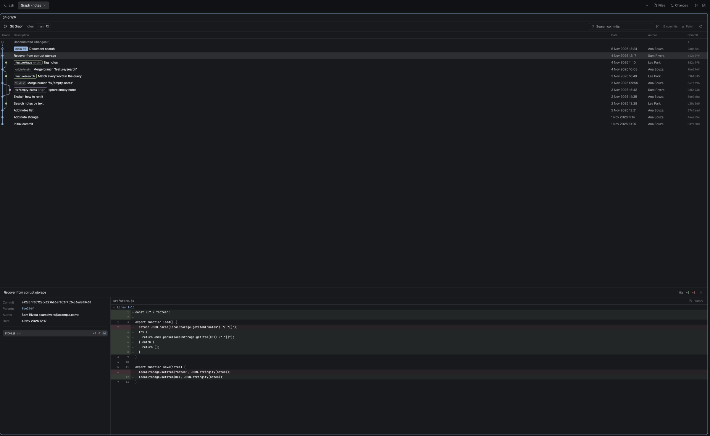

# Bench

Herdr's own window (the `main` layout), with four additions: a Files panel
whose files open in their own tabs, a Limits panel with Claude's session and
weekly limits above Agents, a Scratchpad button after Files in the tab
bar, and a Git Graph button beside it that shows the repository's history
as a VS Code-style graph in a tab. In the Files panel, double-clicking a file opens it in its own tab instead of
a preview squeezed into the panel. The tab is named after the file
and shows it, editable when it's text on this computer: code with syntax colors and line numbers, Markdown
rendered (with a Source button to see the raw text). Clicking the same file
again goes back to its tab instead of opening another. The panel keeps showing
the project's folder while a file tab is in front.

## What you see

- **The panel** (in the right-hand side panel, where Herdr's Files is): looks
  like Herdr's Files. A 42px header with "Files" (semibold) on the left and
  the folder's name on the right (12px, `dim`; `foreground` while a folder
  is shown as root), then a 24px "Up one level" button (14px up arrow,
  `dim`, `hover` background) unless the folder is `/`, and, while a folder
  is shown as root, a "Back to the terminal's folder" button (a folder with
  a check). Below, a scrolling tree with
  6px padding: rows 28px high, indented `8 + 18 × depth` px, rounded 7px,
  `hover` background on hover. Each row: a 12px chevron for folders (right
  when closed, down when open; files get a 12px gap instead), a 14px folder
  or file icon in `muted`, the name (truncated), for a file its size (11px,
  `dim`: "79 B", "4.2 KB", "18 KB", "3.1 MB", in 1024s, one decimal below
  10), and a git mark on the right
  for changed files (11px): `A` in `ansi2` (added or untracked), `D` or `U`
  in `ansi1` (deleted, conflicted), `M` in `blocked` (modified). Folders come
  first, then files, each sorted by name; `.git` is hidden. The panel card
  has a 1px `border` and 10px corners on the `background` color.
- **A file tab**: a tab named after the file (`README.md`), with one mod pane
  filling it. At the top, a 30px bar with a 13px file icon, the file's path
  (12px, `dim`, with your home folder shown as `~`; `machine:` in front for a
  file on another machine) and, for Markdown and SVG files, a small 11px
  "Source" / "Preview" button on the right. Under it, the file:
  - Code and text: an editor with line numbers, folding and syntax
    colors in your theme (keywords `ansi5`, strings `ansi2`, comments `dim`,
    functions `ansi4`, types `ansi3`, numbers `ansi1`, constants `ansi6`),
    12px in your terminal font. Editable for a file on this computer up to
    400 KB; else read-only, with "On <machine>: read-only" or "Larger than
    400 KB: read-only" in the header. Markdown's and SVG's Source is the same
    editor, and Preview shows the edited text.
  - Saving: with edits, the header shows "Edited", "Revert" and "Save" (⌘S
    on macOS, Ctrl+S elsewhere). Save reads the file first; if it isn't what
    the tab last read (another program changed or deleted it), nothing is
    written and the header shows "Changed on disk" (`blocked` color) with
    "Reload" (drop the edits) and "Overwrite". A change on disk with no
    edits just reloads. The write is `writeTextFile(file, text, <what was
    just read>)`. Unsaved edits are a draft in `localStorage` under `draft`,
    `{ base, text }` (keyed by the tab's props): they come back after a
    restart, or when the same file is opened again, and "Changed on disk"
    shows if the file moved on since `base`.
  - Markdown (`.md`, `.markdown`, `.mdx`): rendered, selectable, with 20px
    side and 14px top/bottom padding. A YAML front matter block (`---` …
    `---` at the top) is hidden in the rendered view and shown in Source.
  - Pictures (`.png`, `.jpg`, `.jpeg`, `.gif`, `.webp`, `.bmp`, `.ico`,
    `.svg`): centered with 16px padding, fitted to the tab (scaled up or
    down, keeping their proportions). "Actual Size" in the header shows the
    picture at its own size (at most the tab's), and "Fit" goes back. A file
    on another machine says "Picture preview works for files on this
    computer only".
  - Messages instead of content: "Loading file…", "Binary file · no text
    preview", "This file is no longer available", or "Cannot open this file
    (binary, larger than 1 MiB, or unreadable)".
- **The Limits panel** (in the left sidebar, between Spaces and Agents, 160px
  high, `chrome` background, 1px `border` on top): a header "Limits" styled
  like Agents' (11.5px, medium, `dim`, 16px side padding, 41px high). Per
  account, two meters, "Session" (the 5-hour window) and "Weekly": the name
  in `muted`, the percentage (medium; `foreground` under 50%, else the bar's
  color) and "resets in 1h 12m" on the right (11px, `dim`); under them a 4px
  bar on `raised`, filled to the percentage in `accent` under 50%, `ansi3`
  under 80%, `blocked` from 80%. Each account gets a row above its meters:
  Herdr's 13px Claude icon (`image("icons/claude.svg")`, sized with
  `.w()`/`.h()`), its name (`~/.claude` → "Claude", `~/.claude-personal` →
  "Personal"), and its plan in a small pill (10px, medium, `muted` on
  `raised`, 4px corners), such as "Pro", "Max 5x" or "Team Max 5x". With no saved limits: "No limits yet. They show up once a
  Claude session's status line runs save-limits.sh."
- **After the tab bar's Files button**, on the tab bar's `chrome`
  background and bottom border, 3px apart: a 26px graph button (tooltip "Git
  Graph") and a 26px note button (tooltip "New scratchpad (⌘⇧N)"), each a
  15px icon (`dim`, `hover` background and `foreground` on hover, 6px
  corners).
- **A Git Graph tab**: named "Graph · <repo folder>", one mod pane on
  `background`, 12px text. Top, a 40px bar: graph icon, "Git Graph"
  (semibold), the repo's folder name (`muted`), the current branch in a
  bordered 11px pill with "↑n ↓m" (commits to push and to pull against its
  upstream as last fetched, terminal font, 10px; "gone" when the upstream was
  deleted; a tooltip spells it out), and at the right: a search box (26px
  high, 240px, 170px under 800px wide; search icon, "Search commits", a
  clear button once typed; `accent` border while searching), a "current
  branch only" toggle (branch icon, `selected` when on), a spinner while
  loading, "N commits" (`dim`, "N+" when there are more; "M of N" while
  searching), "Fetch" (a down-arrow icon, 11px `dim`; a spinner and
  "Fetching…" while it runs) and a refresh button. While git is partway
  through something, a 32px banner on `ansi3` at `1f` alpha follows (a
  warning icon in `ansi3`, then semibold "Merging feature into main",
  "Rebasing topic onto main" with "step 2 of 2" (`muted`), "Applying
  patches", "Cherry-picking abc1234 “subject”", "Reverting …" or
  "Bisecting"; then "N files with conflicts" in `ansi3` or "No conflicts
  left" in `muted`; at the right "Continue" (`solid`, only with no conflicts
  left, not for bisect) and "Abort…" ("Stop Bisecting…"), 22px buttons with
  the git command as tooltip). Then a 26px column
  header (11px `dim`): Graph, Description, Date (140px), Author (150px),
  Commit (76px); Date hides under 640px wide, Author under 800px. Then one
  26px row per commit, newest first (`git log --date-order`):
  - **Graph**: one lane every 14px (first at 9px), lines 1.5px, coloured by
    lane from `ansi4, ansi2, ansi5, ansi3, ansi6, ansi1, ansi12, ansi10,
    ansi13, ansi11`. A commit is an 8px dot in its lane's colour; HEAD is a
    hollow ring (2px border, `background` inside). Branching and merging
    lanes are S-curves (cubic, vertical at both ends) within one row. At
    most 24 lanes are drawn.
  - **Description**: labels, then the subject (truncated). A local branch is
    an 18px pill with a 1px border in the commit's lane colour; the current
    branch is filled with that colour, text `background`, semibold. A remote
    branch at the same commit as the local one of the same name rides in its
    pill ("main origin"); others get their own pill with a `border` border
    and `muted` text, faded to 45% once merged into HEAD (except the
    current branch's upstream). Local branches with an upstream add "↑n ↓m"
    in the pill. Tags: `raised` pill, `muted` text, a tag icon.
    Detached HEAD adds a "HEAD" pill.
  - Date as "13 Nov 2026 14:05" (`muted`), author name (`muted`), short hash
    (7 chars, terminal font, 11px, `dim`).
  - With uncommitted changes, a first row "Uncommitted Changes (N)"
    (`muted`, italic, hash "*"): a hollow `muted` dot, joined to HEAD by a
    dashed line (3px dashes).
  - Each stash is a row above the commit it was made on (and among the
    commits by date), in a lane of its own joined to that commit: a hollow
    square (8px, 2px border in the lane colour), a "stash@{n}" pill (lane
    colour border, a box icon in the lane colour, `muted` text) and git's
    subject ("WIP on main: …", "On main: <message>") in `muted`. With the
    branch toggle on, only stashes made on a shown commit. Its details read
    Stash, Commit, "Made on" (the commit, clickable), Author, Date; its
    files are the stashed changes plus, for a stash made with untracked
    files, those as added (tooltip "Untracked when stashed", no History).
  - After 500 commits, a row "Load 500 more commits" (`accent`).
  The selected row is `selected`, others `hover` on hover. Selecting one
  opens a details pane at the bottom (48% of the tab, 200–560px, top
  border): a 36px bar with the subject (semibold), "N files", `+adds`
  (`ansi2`) and `−dels` (`ansi1`) and a close button; below it, left (38% of
  the width, at most 420px, right border): Commit (full hash), Parents (short
  hashes in `accent`, clickable), Author with email, Date, Committer when
  different, then the message body (`muted`), a divider and the changed files
  (26px rows: the name, struck through when deleted; its folder `dim`;
  `+n`/`−n` in mono; a 16px status badge A/M/D/U in `ansi2`/`ansi4`/
  `ansi1`/`ansi3` on its colour at `26` alpha, naming the status on hover).
  Right: a 28px bar with the file's path (terminal font, 11px, `muted`) and
  a "History" button (clock icon, 11px, `dim`; not for untracked files, nor
  for the file whose history is showing), then the selected file's diff as
  VS Code's inline view (19px mono rows,
  scrolling sideways): the old and the new line number in two 38px gutters,
  a `+`/`−` marker, added lines on `ansi2` and removed on `ansi1` at `14`
  alpha (the gutters at `22`). Each hunk starts with a `surface` row with a
  top border, "⋯", "Lines N–M" (or "Line N") in `accent` and git's
  function context after it in `dim`; "No newline at end of file" shows as a dim italic note. At most
  2000 rows, lines clipped at 2000 characters, tabs as 4 spaces.
- **A scratchpad tab**: named "Scratchpad", one mod pane with a plain-text
  editor (13px, your terminal font, no line numbers, soft wrap, 6px padding)
  on `background`. Above it, a 30px strip with a bottom `border`: the note's
  file on the left (`~` for home, "· edited" when it differs from what was
  saved; "Not saved to a file" before), then "Save" (once it has a file) and
  "Save as…", 12px `dim` text buttons with a `hover` background.

## How it behaves

- Double-click a folder: it becomes the panel's root. Up one level shows
  the parent as root (also above the terminal's folder), Back to the
  terminal's folder ends it. The root is kept per terminal location (space,
  machine, folder): `cd` elsewhere and the panel follows the terminal again;
  come back and the pinned root is there.
- Right-click a row: a menu like Herdr's own (31px rows, `selected` for the
  keyboard's row, `hover`, dividers in `border`; ↑/↓, Enter, Esc). A file:
  Open, Open with Default App, Reveal in Finder; a folder: Show as Root, New
  Terminal Here (a terminal tab in that folder); then Cut, Copy and, once
  something was cut or copied, Paste (on a folder "Paste into “name”");
  then Copy Path, Copy Relative Path (to the panel's root); then New
  Folder…, Rename…, Move to Trash…. Right-click the tree's empty space: New
  Folder…, Paste, Reveal in Finder, Copy Path, for the panel's root. Default
  app and Finder only for files on this Mac; the file actions not on
  Windows. A copied path says so in a 2-second toast.
- Cut and Copy remember one item in the files' own clipboard (shared
  `"files-tabs.clipboard"`: `{ path, on, mode, dir }`), not the text one; a
  cut item shows at half opacity until it's pasted. Paste goes into the
  folder clicked, or the file's folder. A copy never replaces anything: a
  taken name becomes "a copy.txt", then "a copy 2.txt" (a folder keeps its
  whole name before " copy"). A cut is refused over an existing name,
  changes nothing where it already is, and empties the clipboard once
  pasted. A folder can't go into itself or below itself. Between two
  machines (or this computer and one) Paste says it isn't supported yet.
  After a paste or a new folder inside a folder, that folder opens.
- New Folder… opens the Rename dialog's twin: "New folder", "untitled
  folder" selected, Create; a name with "/" or one that exists is refused.
- Rename… opens a dialog like Herdr's prompt: the name with its stem
  selected (all of it for a folder or a dotfile), Enter or Rename, Esc or
  Cancel. A name with "/" or one that already exists there is refused in the
  dialog; nothing is overwritten.
- Move to Trash… opens a dialog like Herdr's confirm: "Move “name” to the
  Trash?", with the path, Enter or Move to Trash. It only ever moves to a
  Trash; with none on that machine it says so and deletes nothing.
- Selection: a click selects that row (`selected` background) and does what
  it did before; ⌘-click adds or removes a row; ⇧-click selects the range
  from the last clicked row. Right-click a selected row with others
  selected: Cut N Items, Copy N Items, Copy N Paths (one per line), Move N
  Items to Trash… ("Move 3 items to the Trash?" with their names).
  Right-click a row outside the selection selects just that row.
- Keyboard: a click (or `pane.go` into it, `"focusable": true`) gives the
  panel the keyboard (opening a file hands it to the file's tab). A cursor
  row moves with ↑/↓ (⇧ extends from the
  anchor, like ⇧-click), Home/End; → opens a folder, then steps into it; ←
  closes it, or steps to the folder above. The cursor row scrolls into view.
  `cmd` below is ⌘ on macOS and Ctrl elsewhere. On every platform:
  `cmd-a` selects every shown row, `cmd-c` / `cmd-x` copy or cut the
  selection, `cmd-v` pastes into the selected folder (or the selected file's
  folder, or the root), `cmd-alt-c` copies the paths, Esc clears the filter,
  then the selection.
  - macOS, as in Finder: Enter renames (one row), `cmd-down` / `cmd-o`
    opens a file or makes a folder the root, `cmd-backspace` Move to Trash…,
    `cmd-up` up one level.
  - Linux and Windows: Enter opens a file or opens and closes a folder, F2
    renames, Delete Move to Trash…, `alt-up` up one level.
  They run the row menu's own actions, so Rename and the Trash ask first.
- Quick filter: typing a character (not with ⌘/Ctrl; a space only after the
  first one) starts a filter, shown in a 30px strip under the header with
  the text, the count ("300+" at the limit) and "esc"; Backspace edits it.
  120ms after the last key, `find <root> -iname '*text*'` (skipping `.git`
  and `node_modules`, at most 300) replaces the tree with a flat list: icon,
  name, and its folder in `dim` 11px; names starting with the text first,
  then the shallower ones. The first match is selected. Enter or a double-click
  opens a file; a folder shows in the tree with the folders above it open.
  Windows (no `find`) searches the open folders only.
- A rename, or a cut pasted elsewhere, moves open tabs along: the tab of a
  renamed file takes the new name, a tab inside a renamed or moved folder
  keeps working, also after a restart, and clicking the file under its new
  name goes back to that same tab.
- Click a folder: it opens or closes in place. Click a file: it is
  selected. Double-click a file: a new tab opens in the shown space, named
  after the file, and becomes the shown tab.
- Double-click a file that already has a tab: that tab is shown again; no second tab.
  This works across restarts as long as the tab is still open.
- The panel follows the focused terminal's folder, like Herdr's Files. When the
  focused pane is a file tab (which has no folder of its own), the panel stays
  on the last terminal folder seen in that space, or the folder of any
  terminal in that space, instead of jumping to the home folder.
- The tree refreshes when anything in the folder changes (and every 10 s); git
  marks refresh with it.
- A file tab reloads by itself when the file changes on disk (local files are
  watched; files on another machine are re-read every 10 s). "Source" /
  "Preview" switches a Markdown tab between raw text and rendered text.
- Close a file tab like any tab. Agent statuses play no part in this mod.
- A window that reaches 80%, then 100%, posts one notification each:
  "Claude session limit at 83%", "<Account> (<plan>) · resets in 1h 12m",
  `warning` at 80 and `error` at 100 (a jump straight to 100 says only
  100). Only fresh snapshots (30 minutes) of windows that haven't reset;
  shown ones are kept in shared `"claude-limits.alerted"` as
  `<account>:<window>:<resets_at>:<threshold>` and dropped once that window
  resets, so a restart doesn't repeat them.
- Limits update within a second of a Claude session's status line running
  (the panel watches the folder), and every 30 s the countdowns move on. A
  window whose reset time has passed shows 0% and "reset". A snapshot older
  than 30 minutes says "as of 2h 5m ago" above its meters.
- The note button, or `cmd-shift-n`, opens a new scratchpad tab in the shown
  space and shows it. Each one starts empty; its text is saved on every
  change and survives restarts and updates while the tab stays open. Closing
  the tab is the end of that note, unless it was saved to a file.
- The graph button opens the Git Graph of the focused terminal's repository
  (on that terminal's machine), in the shown space. Clicking it again for the
  same repository goes back to its tab. Outside a repository, a notification
  says so.
- In the graph, clicking a commit selects it and shows its details; clicking
  it again, Esc or the close button hides them. ↑/↓ (or k/j) move the
  selection once the tab has the keyboard. The first changed file's diff
  shows at once; clicking another file shows its diff. A merge shows its
  changes against its first parent. Clicking a parent's hash jumps to it.
  The uncommitted row lists the working tree's changes against HEAD plus
  untracked files (shown as all-added).
- Typing in the search box (or `/`, ⌘F from the list) narrows the list to
  the commits matching every word, in the subject, author, email or a
  ref name, or as the start of the hash; the rows keep their lane colour but
  draw no lines. When the graph holds only part of the history, the first
  search reads all of it once (`log --date-order -n100001` from the same
  starting points; at most 100000 commits, "N of 100000+"), "Searching all
  history…" meanwhile, and again only after the refs move; matches past the
  loaded ones come after them, in the first lane colour, with no "Load
  more" row. Enter or ↓ goes to the first result, Esc clears the search.
  A selected commit stays open while the search changes. The branch toggle
  reads the log from HEAD only.
- "History" over a diff replaces the graph with the commits that changed
  that file, on the branches the graph shows (HEAD only with the toggle
  on) and across renames (at most 2000), drawn like
  search results, under a 30px `surface` strip: clock icon (`accent`),
  "History of <name>" (semibold), the folder (`dim`), "N commits" and "Back
  to graph" (Esc). Search narrows the history too. Selecting a commit opens
  that file's diff in it, under the name it had then. At the commit that
  renamed it (its name differs from the next older entry's), the file is one
  "R" row (`ansi6`, tooltip "Renamed from <old>"; the old name's "D" row
  dropped) and its diff is `diff --find-renames=20% <parent> <commit> --
  <old> <new>` under a "Renamed from <old>" note, counts taken from that
  diff. Back in the graph,
  the selected commit stays selected.
- Right-clicking a commit (not the uncommitted row) selects it and opens a
  250px menu at the pointer (`popover`, 31px rows, `selected` on the
  keyboard's row, dividers, 24px `dim` section headings; ↑/↓, Enter, Esc):
  "Check Out This Commit…" (not on HEAD), "New Branch Here…", "Cherry-pick
  onto <branch>…" (not on HEAD) and "Revert…" (neither on a merge), "Copy
  Hash", "Copy Subject"; then a section per local branch at the commit
  ("main (current)"): "Check Out <branch>" (not the current one), "Pull (N
  commits)" (the current one, when behind), "Push (N commits)…" when ahead
  or "Publish…" with no upstream, "Rename…", "Delete…" (not the current
  one); and per remote branch there of its own, "Check Out as a Local
  Branch". Copying, checking out a branch, pulling (fast-forward only; a
  diverged branch says to merge or rebase in a terminal) and fetching run
  at once, with a notification only on failure. The rest open a 460px
  dialog (`popover`, title, the repository's folder `dim`, what will
  happen in `muted`, buttons Cancel and the action, Enter confirms, Esc
  closes): detaching says no branch will hold new commits; New Branch and
  Rename ask for a name (checked with `git check-ref-format --branch`; New
  Branch also offers "Create and Check Out"); Cherry-pick and Revert say
  where the new commit goes; Push says how many commits go where and that
  it's never forced (Publish: which remote, setting the upstream); Delete
  is red. A delete git refuses because the branch isn't merged asks again,
  "Delete Anyway" (red), saying the commits stay about two weeks in the
  reflog. A cherry-pick or revert that stops on conflicts offers "Abort"
  or "Leave It" (resolve in a terminal); one with nothing to add puts
  things back and says the change is already there. git's last error line
  shows in `ansi1` otherwise. The graph looks again as soon as anything
  ran.
- Right-click a stash: a "stash@{n}" heading, "Apply", "Pop", "Drop…",
  "Copy Hash". Apply and Pop run at once (a toast says so; on conflicts,
  "Applied with conflicts", the stash kept); Drop asks, in red, saying the
  changes are nowhere else. Right-click Uncommitted Changes: "Stash
  Changes…", a dialog with an optional message, "Stash" and "Include
  Untracked". If the stash list changed since the row was drawn, nothing
  runs and it says to pick the stash again.
- The banner's Continue runs `--continue` at once (git's error as a toast if
  it refuses); Abort… asks first (red), saying what's lost: the conflicts
  resolved so far, or for a rebase the commits already replayed. The banner
  goes once git is done.
- The graph refreshes when anything in the repository changes (folder watch
  on this computer) and every 10 s. The log is read again only when HEAD, the
  current branch or a ref moved; otherwise only the uncommitted row updates.
- "Save as…" (⌘⇧S, or ⌘S before the note has a file) opens the system's save
  dialog in the space's folder (home for an SSH space), named after the
  note's first line (`.md`, "Note.md" when empty). The note is written there,
  the tab takes the file's name, and later ⌘S writes to the same file. If
  something else changed that file since, Save refuses with a notification
  instead of overwriting it.

## Built from

- One layout file, `layouts/Bench.json`: a clone of Herdr's
  `main` layout (`cloned_from: {name: "main", version: "0.1.13"}`) with
  one change: the block with id `files` (in the right panel's stack
  `panel-body`) has `content.mod` set to `files-tabs` instead of `files`.
  Keep that id, because the tab bar's Files button selects it. The root also
  has `"preview": "layouts/Bench.svg"`, the picture Settings shows.
  It also adds a block `limits` (`size: {px: 160}`, `min: 80`, mod
  `claude-limits`) in `sidebar-lists` between `spaces` and `agents`. The
  `tabs` block (still Herdr's own `tabs` mod) goes into a row `tab-bar`
  (`size: {px: 42}`, `resizable: false`) with `size: {weight: 1}`, followed
  by a block `tab-bar-extras` (`size: {px: 65}`, mod `tab-bar-extras`).
- One mod folder, `mods/tab-bar-extras/`: `main.js`, `mod.json`
  (`"place": "none"`), `graph.svg` and `note.svg`. The note runs
  `mod.open {name: "scratchpad"}`. The graph finds the repository with `git
  rev-parse --show-toplevel` in the focused pane's folder (`on`: the space's
  machine), then `run("tab.new", { name: "Graph · <folder>", space, mod:
  "git-graph", props: { root, on } })`, and keeps "<machine>|<root>" → tab
  id in shared `"git-graph.open"` (found as for file tabs, below). More
  buttons beside the tab bar go here.
- One mod folder, `mods/git-graph/`: `main.js`, `mod.json` (`"place":
  "none"`, `"focusable": true`), `graph.svg`, `tag.svg`, `refresh.svg`,
  `search.svg`, `branch.svg`, `history.svg`, `fetch.svg`, `stash.svg`,
  `warning.svg`, and
  `actions.js` (the menu and dialogs, opened as overlays of this same mod:
  `openOverlay({ mod: "git-graph", kind: "popup", at: "pointer", props: {
  menu } })` or `kind: "dialog"` with `props: { dialog }`, both carrying the
  commit's facts: root, machine, hash, subject, merge, HEAD, current branch,
  dirty, its branches with upstream/ahead/behind/gone, its remote branches;
  a stash row passes `stash: "stash@{n}"`, the uncommitted row `worktree:
  true`, the banner `op` and its text); it
  also uses Herdr's `mods/pane/close.svg` and
  `mods/workspace-chrome/spinner.svg`. Every git call starts with
  `--no-optional-locks -c core.fsmonitor=false -c diff.autoRefreshIndex=false`
  (as Herdr's Changes mod does) so a refresh writes nothing under `.git`.
  - Data: `rev-parse --verify -q HEAD`, `symbolic-ref -q --short HEAD`,
    `for-each-ref --format=%(objectname)%00%(*objectname)%00%(refname)%00
    %(upstream:short)%00%(upstream:track,nobracket) refs/heads refs/remotes
    refs/tags` (tags by their peeled commit, `<remote>/HEAD` skipped; the
    track reads "ahead 2, behind 3" or "gone"), `for-each-ref --merged=HEAD
    --format=%(refname:lstrip=2) refs/remotes` for the faded remotes, `status --porcelain=v1 -z --no-renames
    --untracked-files=all`, and `log --date-order -n<limit+1>
    --format=%H%x1f%P%x1f%an%x1f%ae%x1f%at%x1f%s%x1e --branches --remotes
    --tags HEAD` (not `--all`, which would draw each stash's index and
    untracked commits; just `HEAD` with the branch toggle on). Stashes: `stash
    list --format=%H%x1f%P%x1f%an%x1f%ae%x1f%at%x1f%gs%x1f%gd%x1e`, drawn
    with their first parent only; the third parent, when there, holds the
    untracked files (`diff <empty tree> <it>`). What's under way: one `sh`
    script that finds `git rev-parse --absolute-git-dir` and checks, in this
    order, `rebase-merge/` (head-name, onto, msgnum, end), `rebase-apply/`
    (`applying` means am; next, last), `MERGE_HEAD` (MERGE_MSG's first line
    names the branch), `CHERRY_PICK_HEAD`, `REVERT_HEAD` (`show -s` for the
    short hash and subject) and `BISECT_LOG`. Conflicts are the `status`
    entries with a `U` on either side, or `AA`/`DD`. Details: `show -s`
    for the message, and `diff <first parent> <commit>` with `--name-status
    -z --no-renames` and `--numstat -z` (a root commit, or an unborn HEAD,
    against the empty tree `4b825dc642cb6eb9a060e54bf8d69288fbee4904`). The
    uncommitted row runs `diff HEAD` the same way plus `ls-files --others
    --exclude-standard -z`, and reads untracked files directly. A file's diff
    is `diff … --no-color --no-ext-diff --no-textconv -- <path>`, parsed from
    the first `@@` on. A file's history: `log --follow -n2000
    --format=%x1e%H%x1f%P%x1f%an%x1f%ae%x1f%at%x1f%s --name-only -z
    <the graph's starting points> -- <path>`, where each record's fields end at a NUL followed by a newline
    and the file's path at that commit.
  - Actions run `git` without the read-only options, through `sh -c
    'GIT_TERMINAL_PROMPT=0 GIT_EDITOR=true exec git "$@"'` so a missing
    password fails and a commit message is taken as is, instead of waiting: `switch <branch>`, `switch --track <remote/branch>`,
    `switch --detach <hash>`, `branch <name> <hash>` or `switch -c <name>
    <hash>`, `branch -m`, `branch -d` (then `-D`), `cherry-pick <hash>`,
    `revert --no-edit <hash>` (stuck: `rev-parse -q --verify
    CHERRY_PICK_HEAD`/`REVERT_HEAD`, then `--abort`), `pull --ff-only`,
    `push <remote> <branch>:<upstream branch>` or `push -u origin <branch>`,
    `fetch --all --prune` (network ones get 120 s), `stash push [-u] [-m
    <message>]`, `stash apply|pop|drop stash@{n}` (only after `rev-parse -q
    --verify stash@{n}` still gives the row's hash: the numbers shift),
    `merge|rebase|am|cherry-pick|revert --continue` and `--abort`, and `bisect
    reset`. Copying uses `pbcopy`
    (else `wl-copy`, `xclip`, `xsel`). Afterwards the overlay sets shared
    `"git-graph.request"` `{ id, at, root, on }` and the graph with that
    repository refreshes (forced) on its next frame.
  - Lanes: walk the commits newest first keeping `lanes[]`, the commit each
    lane waits for. A commit takes the first lane waiting for it (else the
    first free one); other lanes waiting for it end in it; its lane then
    waits for its first parent, and each other parent takes the lane already
    waiting for it or a free one. Each row keeps the lanes before and after
    it and draws: lanes passing by (straight), its own lane in (if a child
    waited) and out (if it has a parent), curves in from the lanes that ended
    and out to its other parents. The uncommitted row is a fake commit `*`
    whose parent is HEAD.
  - Drawing: per row, one `window.paint_path(PathBuilder.stroke(1.5)...
    .build(), color).absolute().inset_0()` per line or curve (dashed with
    `.dash_array([3, 3])`), in a `relative` box as wide as the lanes, and the
    dot as an absolutely placed 8px rounded `div`.
  - The list is a `v_virtual_list` keyed by hash, `.absolute().inset_0()` in a
    `relative` box, with a `VirtualListScrollHandle` so ↑/↓ keep the
    selection on screen.
- One mod folder, `mods/scratchpad/`: `main.js` and `mod.json`
  (`"place": "none"`, `"overlay": {width: 1, height: 1}`).
  `main.js` default-exports a `View` with two roles, chosen by `props()`:
  - **`{ id }` → a note tab**: `EditorState.new({ value, font_family,
    font_size: 13, line_numbers: false, folding: false, soft_wrap: true })`,
    with the text in `localStorage` under `note:<id>` on every `change`.
    `close()` saves and `await localStorage.flush()` but doesn't delete it:
    `close()` also runs when Herdr quits. The linked file is under `file:<id>`.
    The dialog is `osascript` `choose file name` on macOS, else `zenity
    --file-selection --save --confirm-overwrite`, else `kdialog
    --getsavefilename` (`exec` with a 10-minute timeout); the file is written
    with `writeTextFile(path, text, expected)`, where `expected` is the file as
    the dialog found it, or the text this note last wrote (so a changed file
    rejects). Keys: `on_key_down` on the tab's root, `cmd-s` and `cmd-shift-s`.
  - **`{ overlay }` → `mod.open:scratchpad`**: closes the overlay and opens a
    tab, `run("tab.new", { name: "Scratchpad", space: <shown space id>,
    mod: "scratchpad", props: { id: <new random id> } })`.
- `keys.json`: `{"global": {"cmd-shift-n": "mod.open:scratchpad"}}`.
- One mod folder, `mods/claude-limits/`: `main.js`, `mod.json`
  (`"place": "none"`, `"title": "Limits"`) and `save-limits.sh`.
  - `save-limits.sh` reads the status line's JSON on stdin and, with `jq`,
    writes `{account, plan, updated, rate_limits}` on one line to
    `~/.cache/herdr-claude-limits/<account>.json`, where the account is the
    basename of `CLAUDE_CONFIG_DIR` (default `~/.claude`) without its dot. It
    rewrites only when `rate_limits` changed or the file is a minute old,
    through a temp file and `mv`. `plan` comes from `oauthAccount` in
    `$CLAUDE_CONFIG_DIR/.claude.json`, or `~/.claude.json` when that isn't
    set (not `~/.claude/.claude.json`, which can be an old leftover):
    `organizationType` without `claude_`, capitalized. Max adds the `5x`/`20x`
    ending of its rate limit tier ("Max 5x"). Team adds "Max" and the ending
    of `userRateLimitTier`, the seat's own tier, when it has one
    ("Team Max 5x", else "Team"). "" if unknown. `rate_limits` is what Claude Code passes:
    `five_hour` and `seven_day`, each `{used_percentage, resets_at}` (Unix
    seconds).
  - `main.js` default-exports a `View`: it reads every snapshot with one
    `exec("sh", ["-c", 'for f in "$1"/*.json; do [ -f "$f" ] && cat "$f" && echo; done', "limits", dir])`,
    sorted by account; reloads on `watchFolder(dir)` and `cx.timer.every(30000)`.
- One mod folder, `mods/files-tabs/`: `main.js`, `viewer.js`, `menu.js`,
  `dialog.js`, `moves.js`, `file-icons.js`, `mod.json` (`"place": "none"`: it shows only where the
  layout puts it), and six icons (`chevron-down.svg`, `chevron-right.svg`,
  `file.svg`, `folder.svg`, `up.svg`, `home.svg`).
- Sizes come from the same `sh` listing as the tree, with no extra call: it
  prints each entry as `kind\0name\0` (at most 500), then the pair `z\0z\0`,
  then one `stat -L` for all the folder's files, `stat -c "%s %n"` where GNU
  stat answers `stat -c %s /`, else BSD's `stat -f "%z %N"`. The fields are
  read in pairs, since a name can be "z" and a kind (d or f) can't; each
  `<bytes> <path>` line gives the size for that name. Windows folders have no
  sizes.
- The row menu (`menu.js`) and the dialogs (`dialog.js`) are more copies of
  `files-tabs`, chosen by `props()`: `{ menu }` as a popup (230px wide),
  `{ dialog }` as a dialog (440px wide). Each copy has its own module state,
  so what the panel must do (open a file in a tab, Show as Root, reload
  after a rename or a trash) goes to it as shared `"files-tabs.request"`:
  `{ id, at, location, kind: "open" | "root" | "refresh" | "expand", path }`
  (expand: reload with that folder and its parents open); the panel acts
  once per id, only for its own terminal location and within 5 s.
  Commands: `open` / `open -R`; `printf %s "$1" | { pbcopy || wl-copy ||
  xclip -selection clipboard || xsel -b; }`; rename `cd "$1"; [ -e "$3" ] ||
  [ -L "$3" ] && exit 3; mv -n -- "$2" "$3"` on the file's machine; trash
  `/usr/bin/trash "$1"` (macOS 15+), else Finder `delete` through
  `osascript` with the path as an argument; elsewhere `gio trash --` or
  `trash-put --`, else exit 4 ("no Trash"). Never `rm`. New folder: `cd "$1";
  [ -e "$2" ] || [ -L "$2" ] && exit 3; mkdir -- "$2"`. Paste, on the
  machine of both: refuse a folder into itself (`case "$dir/" in "$src"/*`,
  exit 5) and a missing source (exit 4); a cut is `mv -n` unless the name is
  taken (exit 3); a copy finds a free "stem copy[ n].ext" and runs
  `cp -R -p`.
- `moves.js`: shared `"files-tabs.open"` ("<machine>|<path>" → tab id, the
  tab to go back to) and `"files-tabs.moved"` (old "<machine>|<path>" → new
  path, the newest 100). `recordMove` (after a rename and after each cut
  item pasted) first drops moves away from the new path or from inside it,
  so a rename back (a → b → a) doesn't loop, then re-keys the open tabs at
  or below the old path and runs `tab.rename` for the tab of the file
  itself. A file tab resolves its props' path through the moves, following
  the longest matching folder, on start and on every render; a new
  extension changes how it shows the file.
- The files' clipboard holds several paths (`{ paths, on, mode }`; an older
  `{ path }` still reads). Paste runs each in turn, a failure doesn't stop
  the rest, a cut keeps only what didn't move; the trash command takes every
  path at once (`/usr/bin/trash "$@"`, `gio trash -- "$@"`, `trash-put --
  "$@"`, Finder one by one).
- Show as Root: a module-level map from the terminal location (the JSON of
  `{cwd, on, space}`) to a pinned folder; the panel's folder and its cache
  key come from that pinned folder when there is one. Double-click comes
  from `on_click`'s `click_count >= 2`.
- One bundled mod folder, `mods/better-icons/`: [Better Icons](https://github.com/munza/herdr-mods/tree/main/better-icons)
  as published (commit `ffbdb6d`, Material Icon Theme 5.40.0: `icons.json`,
  1,184 SVGs in `icons/`, `file-icons.js`, `main.js`, `mod.json` with
  `place: none`, `mod.schema.json`, `LICENSE-material-icon-theme.txt`).
  Don't edit it; to update, copy a newer release over it.
- Colour icons: `files-tabs/file-icons.js` is a byte-for-byte copy of Better
  Icons' own (a mod can't import from another's folder), which reads the
  icons by path from `mods/better-icons/`. The
  panel and each file tab call `followFileIcons(this, cx)` once, then draw
  `fileIcon(this.fileIcons, <full path>, { dir, open, light: isLight(theme().background) })`
  with `image(...).w(14).h(14)` (13 in a tab's title row); `image`, not
  `svg`, so the icon keeps its colours. With no Better Icons installed it
  returns null and the plain `folder.svg` / `file.svg` show, tinted `muted`,
  so the panel still works if someone leaves Better Icons out.
  Installing or updating Better Icons shows within 10 seconds, no restart.
- `main.js` default-exports one `View` with two roles, chosen by `props()`:
  - **No props → the panel.** A lazy tree of `location().cwd`. Folders are
    listed with `exec("sh", ["-c", <script>, "files", path], { on })`, at
    most 500 entries per folder and 5,000 in all; git marks come from
    `git rev-parse --show-toplevel` and
    `git --no-optional-locks -c core.fsmonitor=false status --porcelain=v1 -z --no-renames --untracked-files=all`.
    Refresh on `watchFolder(cwd)` (local) and `cx.timer.every(10000)`.
    Opened folders are remembered per location.
  - **`{ file, on }` → a file tab**, drawn by `viewer.js`: `readTextFile(file, { on })`,
    `EditorState.new({ language, readonly: <not editable>, … })` + `Editor.new(state)`
    for code, `TextView.markdown(id, text).selectable(true)` for Markdown;
    `watchFolder(parent folder)` locally, a 10 s timer remotely. The
    `EditorState` is released on reload and in `close()`.
- Opening a file: `run("tab.new", { name: <file name>, space: <shown space id>, mod: "files-tabs", props: { file: <absolute path>, on: <machine or null> } })`;
  going back: `run("tab.select", { id })`.
- Which tab shows which file: shared value `"files-tabs.open"`, an object
  from `"<machine>|<absolute path>"` to tab id. Ids of tabs that no longer
  exist are dropped whenever an entry is added.
- The panel's folder (`location()`): `focused()`, `panes()`, `spaces()`. A
  focused pane with `terminal: null` is a mod pane, so the last terminal
  location of that space is used (kept in a module-level `Map`).
- Derived from the Files mod shipped with Herdr 0.1.13 (Apache-2.0, see
  `LICENSE`). Changed: a file click opens a tab instead of an in-panel
  preview (the preview, its back arrow and the remembered previewed file are
  removed); the panel's location falls back for mod panes; `viewer.js` added.

## Watch out

- The commit list's rows can't take mouse handlers: right-clicks go to the
  list's `on_item_secondary_click((key, event, cx) => …)`. A menu or dialog
  overlay keeps `props().overlay` from its constructor to close itself
  later; `props()` belongs to the frame.

- Better Icons' folder must be named `better-icons`: every mod that uses it
  reads `mods/better-icons/icons/<name>.svg`. If one is already installed,
  keep it rather than install this copy under another name.

- A block with no `size` in a row takes all of it: the `tabs` block needs
  `size: {weight: 1}`, or the button block next to it gets no width.
- The button can't go inside the tab bar's own `+` menu without cloning
  Herdr's `tabs` and `new-menu` mods, which then stop getting Herdr's fixes.
  A block beside the tab bar keeps both stock.
- On Linux and Windows, Herdr's tab bar draws the window buttons at its right
  end, so the note button sits after them there.
- A side panel of your own (another child of `panel-body`, opened by a
  button in `tab-bar-extras`) closes on every space switch unless its id is
  in shared `workspace.panels`: Herdr's tab bar remembers the panel per
  space but restores only the ids listed there (Files and Changes unless the
  person changed it). That list is shared by every layout.
- A row of a `v_virtual_list` can't register `on_click` (the renderer
  throws, and the rows draw nothing at all): give the list
  `.on_item_click((key, cx) => …)` and key the rows (the hash, "more").
  `hover` styles in rows are fine.
- `herdr-app check` doesn't run a virtual list's rows, so an error there
  passes the check and shows only as an empty list: try it in the app.
- A `v_virtual_list` given `.size_full()` directly inside a flex child drew
  nothing; `.absolute().inset_0()` inside a `relative` box works.
- In a mod, `window` is GPUI's window (with `paint_path`); `herdr`'s
  `window()` is a different thing (the app window's buttons). Don't import
  `window` from `herdr` in a mod that draws paths.
- Herdr's `image()` only loads files inside its own folder, and doesn't fit
  itself to a box: given a width and height it takes the width and follows
  its own proportions, so a square picture in a wide box overflows. The
  viewer fits it itself: the picture area's size from `on_size_change`
  (unzoomed, so divided by `settings().zoom`: `w()`/`h()` are zoomed), the
  picture's own size from `sips -g pixelWidth -g pixelHeight` on macOS,
  else the last "W x H" in `file -b` (an SVG: its width/height, else its
  viewBox), then `image().w(w * s).h(h * s)` with `s` the smaller of the two
  ratios. Without a size it falls back to its own size, at most the tab's.
  It copies the picture to
  `~/.config/herdr-app/data/files-tabs/images/<random>.<ext>`, makes a new copy on every change (a new name,
  so no cached old picture), deletes it in `close()`, and at its first start
  deletes copies older than a day (closing a whole space doesn't call
  `close()`).

- Claude Code gives the session and weekly limits only to its status line,
  so the panel can't know them unless a status line saves them. Asking
  Anthropic's usage endpoint would mean reading the Claude login from the
  Keychain and going online; this layout doesn't.
- Limits are only as new as the last status line run. With no Claude session
  open, the numbers stay where they were (and say how old they are after 30
  minutes); a passed reset time still shows as 0%.

- Settings → Look labels a layout you add with its file name, exactly as
  written, and names may only use letters, digits, `-` and `_` (no spaces),
  so the file is `Bench.json`.
- It has to ship as a layout. Herdr's own layouts are read-only: a mod with
  `"place": "right"` is never docked into `main` (Herdr doesn't even mark
  it seen), so on stock Herdr a mod alone shows nothing.
- In a mod, `run()` returns `null`, so `tab.new` doesn't tell you the new
  tab's id. Record the space's tab ids before calling it, then on the next
  `render` look for a new tab with the file's name and store its id.
- `panes()` doesn't expose a mod pane's props, so you can't find a file's tab
  by looking at panes: keep the shared map.
- A mod pane has no `cwd`. Without the fallback, focusing a file tab sends
  the panel to the space's folder, which is often the home folder.
- `readTextFile` reads at most 1 MiB; the editor gets at most 400,000
  characters, then "… (file truncated)".
- `watchFolder` only works on this computer. A remote file must be polled.
- Two files with the same name in different folders get tabs with the same
  name. The map uses full paths, so going back still finds the right tab.
- The mod reaches no network. It runs `sh` (to list folders) and `git`, and
  reads the files you click, anywhere the panel can show.
- If you install it under another name, change the `mods/files-tabs/` icon
  paths in both files, `mod: "files-tabs"` in `tab.new`, and the shared key.

## Done when

- `herdr-app check` passes for every folder in `mods/`.
- The note button shows after Files at the end of the tab bar. Clicking it,
  or `cmd-shift-n`, opens an empty Scratchpad tab, and its text is still
  there after restarting Herdr. "Save as…" writes it to the chosen file and
  renames the tab; ⌘S after an edit saves again.
- With the status line line added, `~/.cache/herdr-claude-limits/` has one
  file per account, and the Limits panel shows the same session and weekly
  percentages as Claude Code's own `/usage`.
- The graph button, in a git repository, opens "Graph · <folder>" with one
  row per commit, coloured lanes, branch and tag labels, and an
  "Uncommitted Changes" row when the tree is dirty; clicking it again shows
  the same tab. In a repo with a merged branch, the branch's lane curves out
  of the merge commit and back into the commit it started from. Clicking a
  commit shows its files and the first file's diff. Typing a word from one
  commit's subject leaves only that commit ("1 of N"); on a branch one commit
  ahead of its upstream, the branch pill reads "↑1". In a repo where a file
  was renamed, its History lists the commits from before the rename, and
  selecting one shows the diff under the old name; the renaming commit shows
  one "R" file with only the lines that changed, and a commit to the file on
  an unmerged branch is listed too. In a repo with more than 500 commits,
  searching a word from the oldest commit's subject finds it. Right-clicking a commit
  on another branch offers "Cherry-pick onto main…"; confirming adds the
  commit to main and the graph shows it at once. Deleting an unmerged
  branch asks a second time, "Delete Anyway". After `git stash -u`, a
  "stash@{0}" row sits above HEAD with a square dot, and selecting it lists
  the stashed and untracked files; Pop brings both back and the row goes. A
  `git merge` that stops on a conflict shows "Merging <branch> into main ·
  1 file with conflicts"; after `git add` it reads "No conflicts left" with
  Continue, which makes the merge commit and the banner goes. A rebase that
  stops shows "Rebasing topic onto main · step 2 of 2".
- Settings → Look shows "Bench" with its preview; with it chosen
  (or after `layout.switch {"name":"Bench"}`), the tab bar's Files
  button opens the panel and it lists the focused terminal's folder with git marks.
- Double-clicking a `.js` file opens a tab named after it, with line numbers and
  syntax colors; double-clicking it again in the panel shows that same tab.
- Double-clicking a `.md` file shows it rendered without its front matter;
  "Source" shows the raw text and "Preview" goes back.
- With a file tab in front, the panel still lists the project's folder, not
  the home folder.
- Editing the open file on disk updates the tab within a second or two.
- Typing in a file tab shows "Edited"; ⌘S writes the file and "Edited" goes.
  Changing the file in a terminal while the tab has edits, then ⌘S, shows
  "Changed on disk" and writes nothing until Overwrite.
- With the panel clicked, ↓/↑ move the selection, Enter renames on macOS
  (opens elsewhere), ⌘C then ⌘V on a folder pastes a copy into it, and typing
  `menu` lists `mods/files-tabs/menu.js`; Esc brings the tree back.
